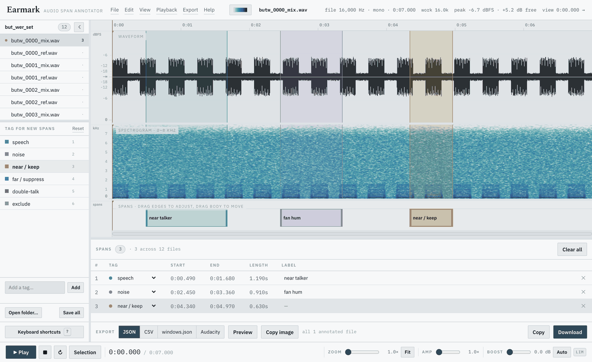
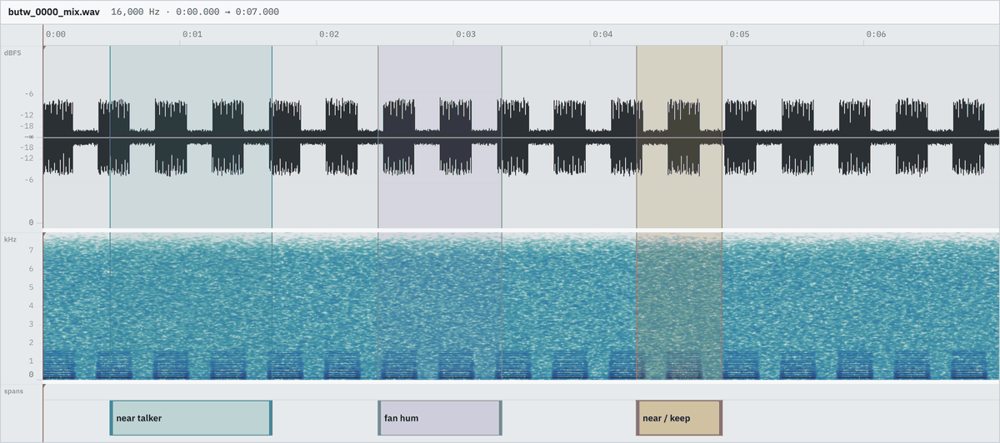
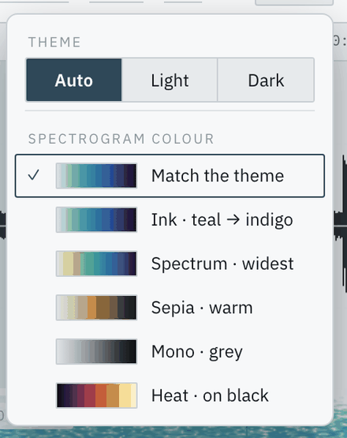
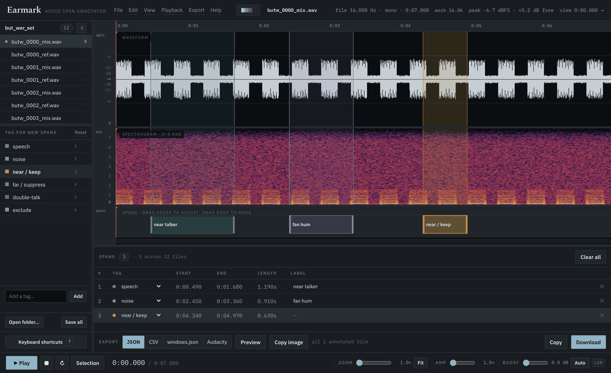

# Earmark

**English** · [繁體中文](README.zh-TW.md)

**[Open Earmark online](https://mcw519.github.io/Earmark/)**

A single-file audio span annotator. Open `earmark.html` in a browser and mark time spans on a
waveform — tag them, label them, export them. Decoding, waveform, spectrogram, resampling and
export all happen in the tab: no audio leaves the machine, and there is no build step, no
server and no dependencies.

Built for preparing speech-enhancement eval data — marking which regions must survive
processing and which must be attenuated — but it works as a general span annotator.

## Download

**[earmark.html](https://github.com/mcw519/Earmark/releases/latest/download/earmark.html)**
— one file. Open it in a browser and you are done: no build step, no server,
no dependencies, nothing to install.

## Getting started

1. **Load audio.** Drag files or a folder onto the window, or use *File ▸ Open folder…*.
   A folder replaces the working set — it asks first if that would discard spans — while
   dropping loose files adds to it. A `<name>.spans.json` sitting next to an audio file is
   picked up automatically.
2. **Mark a span.** Drag a range across the waveform or spectrogram, then press
   <kbd>Enter</kbd>. It appears in the lane below and as a row in the table.
3. **Tag and label it.** Pick a tag in the left rail before pressing <kbd>Enter</kbd>, or
   change it afterwards in the table. Type a free-text label in the Label column. Add your own
   tags at the bottom of the rail — they are remembered between sessions.
4. **Adjust.** Drag a span's edges or its body in the lane, or edit the numbers in its row.
   <kbd>⌘Z</kbd> undoes anything you do to spans.
5. **Move through the folder.** <kbd>[</kbd> and <kbd>]</kbd> step between files. Each file
   keeps its own spans and its own undo history, so nothing is lost on the way.
6. **Export.** Pick a format at the bottom of the span sheet and hit *Download*, or *Preview*
   to open the result in its own tab. With a folder loaded, one export covers every annotated
   file. On Chromium, *Save all* writes a `.spans.json` sidecar next to each audio file.

## Reading the display

The heading bar carries the readouts — file, selection, format, working rate, level — and the
bottom bar carries only controls, so nothing reflows while you drag or play.

Beside the waveform the vertical axis is amplitude in dBFS; beside the spectrogram it is
frequency in kHz, spanning the working rate's Nyquist.

`Amp` magnifies the waveform for quiet files. It is a display gain only — it never touches the
audio or the export — and the dBFS axis moves with it so the view stays honest. `Boost` is
playback gain behind a limiter, so it cannot clip; `Auto` sets the largest boost the file takes
with no limiting at all.

## Copying the view

*Copy image* puts what you are looking at on the clipboard as one picture: waveform,
spectrogram, the span lane with its labels, and both axes, captioned with the file and the
visible time range. Where a browser refuses image writes it saves a PNG instead.

## Themes and colour

The swatch in the heading bar opens the theme and colour panel: auto / light / dark, plus five
spectrogram ramps. Each ramp is monotonic in lightness and respaced at equal perceptual
distance, so a step in energy always looks like the same size step.

  

## Keyboard

| | | | |
|---|---|---|---|
| <kbd>Space</kbd> | play / pause | <kbd>⇧Space</kbd> | play selection |
| <kbd>Enter</kbd> | add span from selection | <kbd>1</kbd>…<kbd>9</kbd> | pick tag |
| <kbd>S</kbd> / <kbd>E</kbd> | set start / end at playhead | <kbd>⌫</kbd> | delete selected span |
| <kbd>⌘Z</kbd> | undo | <kbd>⇧⌘Z</kbd> | redo |
| <kbd>[</kbd> <kbd>]</kbd> | previous / next file | <kbd>L</kbd> | loop selection |
| <kbd>+</kbd> <kbd>−</kbd> <kbd>0</kbd> | zoom in / out / fit | <kbd>←</kbd> <kbd>→</kbd> | nudge 1 s (<kbd>⇧</kbd> 0.1 s) |
| <kbd>G</kbd> | auto boost | <kbd>\\</kbd> | toggle the file list |
| <kbd>⌘S</kbd> | save spans into folder | <kbd>⌘E</kbd> | download export |
| <kbd>⇧⌘C</kbd> | copy the view as an image | <kbd>?</kbd> | the full list, in the app |

## What it does

**Files** — single files, a whole folder, or drag-and-drop (folders included). Each file keeps
its own spans. Pane sizes, the file-list/tag split and the rail width are draggable and
remembered.

**Sample rate** — *Playback ▸ SR* defaults to *Auto · file rate*: each file is decoded back to
its own rate, so the spectrogram spans the file's real Nyquist and the FFT resolution follows
it (bin width = rate/1024). Choose an explicit 8–48 kHz to force a resample instead; that
changes playback, the drawing and the exported metadata. Export the resampled audio with
*Export ▸ Download audio as WAV*.

**Spectrogram** — auto-ranged to the loudest bin on screen, so quiet files are not blank and
loud ones are not saturated. The FFT runs in a worker, so zooming and panning stay smooth while
it catches up; where a worker cannot be created it falls back to computing inline.

**Undo** — every span edit is undoable: adding, deleting, retagging, relabelling, dragging,
importing, and *Clear all*. Typing a label undoes as one step, not one keystroke at a time.
Each file carries its own history.

**Export** — JSON, CSV, `windows.json` (keep/suppress windows for an eval harness), or Audacity
labels, per file or per folder.

**Tags** — edit the palette in the left rail; it is kept in `localStorage` and survives reloads.
Importing a span file creates any tags it references. *Reset* restores the built-in set.

## Notes

- The `<link>` to Google Fonts at the top of the file is optional — it supplies Spectral and
  IBM Plex when online. Delete that one line for a fully offline file; the fallback stacks take
  over.
- Tags, layout and theme are stored per origin in `localStorage`. GitHub Pages, a local server
  and opening from disk (`file://`) each have their own settings.
- Writing sidecars into a folder needs the File System Access API (Chromium). Elsewhere a folder
  loads read-only and you export by download instead.
- Imported spans are trimmed to the audio length, and any starting past the end are dropped —
  otherwise they would sit off the timeline where they cannot be seen or dragged.

## License

[MIT](LICENSE)
