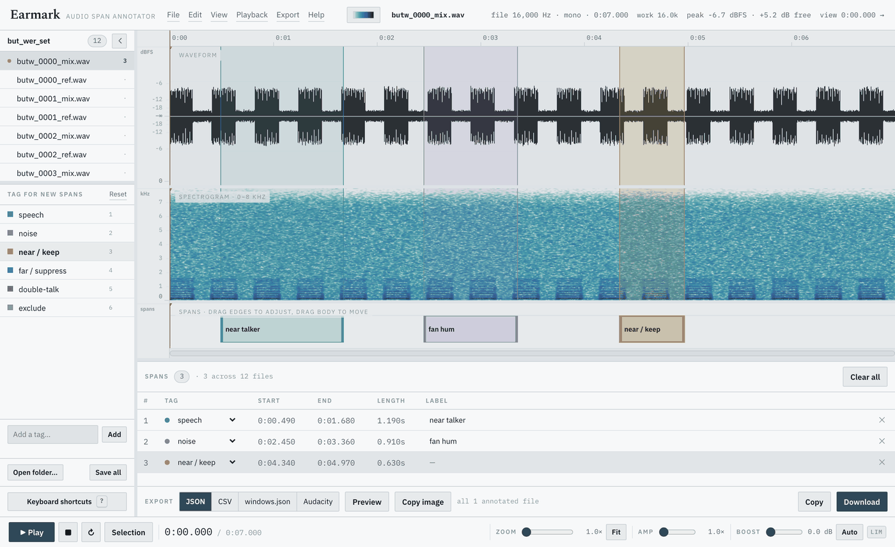
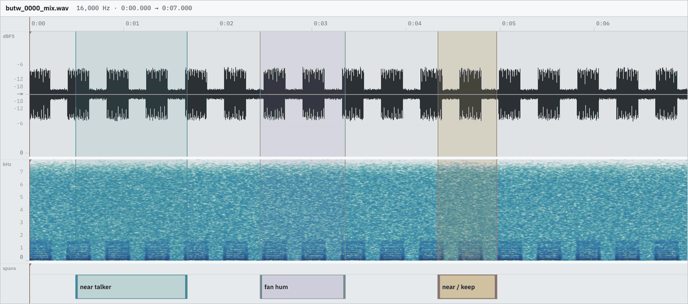
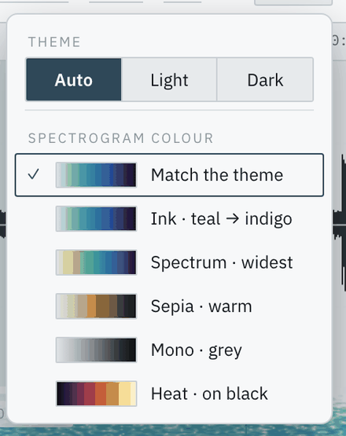
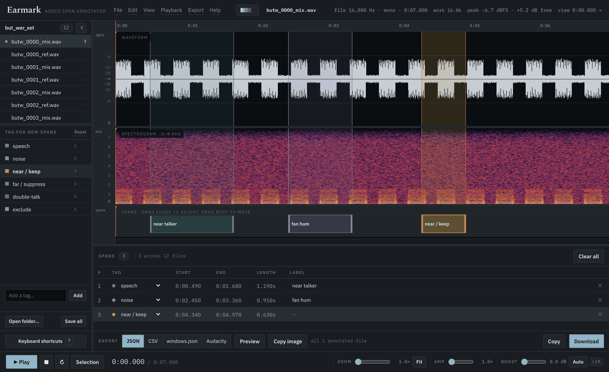

# Earmark

[English](README.md) · **繁體中文**

單一檔案的音訊區段標註工具。用瀏覽器打開 `earmark.html`，在波形上圈出時間區段，
貼標籤、寫註記、匯出。解碼、波形、頻譜、重採樣、匯出全部在分頁裡完成：音訊不會離開你的電腦，
也沒有建置流程、沒有伺服器、沒有相依套件。

原本是為了準備語音增強的評測資料而做的——標記哪些區段必須被保留、哪些必須被抑制——
不過拿來做一般的區段標註也適用。

## 開始使用

用瀏覽器打開 `earmark.html`，安裝就這樣而已。

1. **載入音訊。** 把檔案或整個資料夾拖進視窗，或用 *File ▸ Open folder…*。
   資料夾會**取代**目前的工作區——如果這會丟掉已標註的區段會先跳出確認——拖零散檔案則是加進去。
   音檔旁邊如果有同名的 `<name>.spans.json`，它的區段會一起載入。
2. **圈出區段。** 在波形或頻譜上拖出一段範圍，然後按 <kbd>Enter</kbd>。
   區段會出現在下方的 span 軌，同時在表格裡新增一列。
3. **貼標籤、寫註記。** 按 <kbd>Enter</kbd> 之前先在左欄選好標籤，或事後在表格的 TAG 欄改。
   LABEL 欄可以自由填字。左欄下方可以新增自己的標籤，關掉重開仍會留著。
4. **微調。** 在 span 軌上拖區段的邊界或整段拖移，也可以選取該列直接改數字。
   <kbd>⌘Z</kbd> 可以復原任何對區段的操作。
5. **走過整個資料夾。** <kbd>[</kbd> 和 <kbd>]</kbd> 切換上一個／下一個檔案。
   每個檔案各自保有自己的區段和自己的復原歷史，切來切去不會弄丟。
6. **匯出。** 在 span 表格下方選格式後按 *Download*，或按 *Preview* 開在獨立分頁看結果。
   載入資料夾時，一次匯出涵蓋所有有標註的檔案。在 Chromium 上也可以用 *Save all*，
   把 `.spans.json` 直接寫回每個音檔旁邊。

## 怎麼看這些刻度

頂列放的是讀數——檔名、選取範圍、格式、工作取樣率、電平；底部那條只放控制項，
所以拖曳或播放時版面不會跟著跳動。

波形左側的縱軸是振幅（dBFS），頻譜左側是頻率（kHz），範圍對應目前工作取樣率的 Nyquist。

`Amp` 是給小聲檔案用的波形放大。它只影響顯示，不會動到音訊也不影響匯出，
而且 dBFS 縱軸會跟著移動，所以放大後不會誤判電平。`Boost` 是播放增益，
後面接了限幅器所以不可能爆音；`Auto` 會算出這個檔案在完全不觸發限幅的前提下能推到的最大值。

## 把畫面複製出去

*Copy image* 會把你正在看的畫面複製成一張圖到剪貼簿：波形、頻譜、帶標籤的 span 軌、
橫軸與縱軸都在裡面，抬頭還標了檔名和可視時間範圍。瀏覽器不允許寫入圖片時會改成存成 PNG。

## 主題與配色

頂列的色票會打開主題與配色面板：auto / light / dark，加上五種頻譜色階。
每一種色階的明度都是單調遞減、步階以等感知距離重新排過，所以能量差一階，看起來就是差一階。

  

## 快捷鍵

| | | | |
|---|---|---|---|
| <kbd>Space</kbd> | 播放／暫停 | <kbd>⇧Space</kbd> | 播放選取範圍 |
| <kbd>Enter</kbd> | 把選取範圍變成區段 | <kbd>1</kbd>…<kbd>9</kbd> | 選標籤 |
| <kbd>S</kbd> / <kbd>E</kbd> | 以播放頭設起點／終點 | <kbd>⌫</kbd> | 刪除選中的區段 |
| <kbd>⌘Z</kbd> | 復原 | <kbd>⇧⌘Z</kbd> | 重做 |
| <kbd>[</kbd> <kbd>]</kbd> | 上一個／下一個檔案 | <kbd>L</kbd> | 循環播放選取範圍 |
| <kbd>+</kbd> <kbd>−</kbd> <kbd>0</kbd> | 放大／縮小／全覽 | <kbd>←</kbd> <kbd>→</kbd> | 移動 1 秒（<kbd>⇧</kbd> 0.1 秒） |
| <kbd>G</kbd> | 自動增益 | <kbd>\\</kbd> | 收合／展開檔案清單 |
| <kbd>⌘S</kbd> | 把區段寫回資料夾 | <kbd>⌘E</kbd> | 下載匯出檔 |
| <kbd>⇧⌘C</kbd> | 把檢視複製成圖片 | <kbd>?</kbd> | 在程式裡看完整清單 |

## 功能

**檔案** — 支援單檔、整個資料夾，以及拖放（含資料夾）。每個檔案各自保有自己的區段。
各面板高度、檔案清單與標籤區的分隔、左欄寬度都可以拖曳調整，而且會被記住。

**取樣率** — *Playback ▸ SR* 預設是 *Auto · file rate*：每個檔案都會被解回它自己的取樣率，
所以頻譜的範圍對應到檔案真正的 Nyquist，FFT 的解析度也跟著走（bin 寬度 = 取樣率 / 1024）。
也可以指定 8–48 kHz 強制重採樣，那會同時改變播放、繪製與匯出的中繼資料。
重採樣後的音訊可以用 *Export ▸ Download audio as WAV* 匯出。

**頻譜** — 動態範圍自動對齊畫面上最響的頻段，所以小聲的檔不會一片空白、大聲的檔也不會糊成一團。
FFT 跑在 worker 裡，所以縮放和平移時畫面不會卡住，頻譜會慢一拍跟上；
若環境不允許建立 worker，會自動退回主執行緒計算。

**復原** — 對區段的每一種操作都可以復原：新增、刪除、改標籤、改註記、拖曳、匯入，
連 *Clear all* 都可以。打一整個註記算一步，不是一個字一步。每個檔案各自帶著自己的歷史。

**匯出** — JSON、CSV、`windows.json`（給評測流程用的 keep/suppress 區段），或 Audacity 標籤，
可以單檔也可以整個資料夾。

**標籤** — 在左欄編輯標籤組；內容存在 `localStorage`，重開仍在。匯入 span 檔時，
檔案裡用到但清單沒有的標籤會自動建立。按 *Reset* 可以還原成內建的那組。

## 注意事項

- 檔案開頭那行 Google Fonts 的 `<link>` 是可選的——連線時它提供 Spectral 與 IBM Plex 字體。
  想要完全離線就把那一行刪掉，`:root` 裡的備援字體會接手。
- `localStorage` 是綁 origin 的，所以從硬碟直接開（`file://`）和透過本機伺服器開，
  標籤、版面、主題會是兩份各自獨立的資料。
- 把區段寫回資料夾需要 File System Access API（Chromium）。其他瀏覽器上資料夾是唯讀載入，
  改用下載的方式匯出。
- 匯入的區段會被裁到音檔長度之內，起點超出結尾的會被丟棄——否則它們會停在時間軸外面，
  既看不到也拖不動。

## 授權

[MIT](LICENSE)
